Email got overcomplicated over the years: 

- **Slow.** Mail takes forever to load, open and search.
- **Unreliable.** Sync stalls and sends fail, and it's hard to understand why.
- **Overwhelming.** Ads, spam and mail you never asked for bury the mail that matters.
- **Hard to search.** By sender, subject or attachment: slow, and often the wrong results.

MiniMail is a desktop email client built on a different question:

> ### How simple can we make it?

## The minimum


Your mail can be in four places: Inbox, Archive, Trash and Spam. That's it. No written rules, no folders inside other folders.

> Oh, but how am I going to sort and find all my mail in just those four folders? It's going to be a mess, right?

No, because there are categories:



**These categories sort themselves.** Newsletters, ads, notifications and codes each collapse into one card. You describe what type of emails you want in that category and AI files the mail for you.

That way your mail stays findable, and the app around it stays simple and lightweight.

- **Fast.** Your inbox is on screen as soon as the window opens.
- **Nothing fails silently.** A send is confirmed or the error is shown, and every failure or server-side update is transparent to you.
- **Sandboxed mail.** No scripts, no forms, and no remote images unless you allow them.
- **One inbox, no server.** Gmail, Outlook, Zoho or any other IMAP account in one list. Credentials stay in your OS keychain.


## Run it

```bash
npm install --legacy-peer-deps
npm run dev        # the desktop app
npm run dev:web    # the UI alone, with demo data and no accounts
```

## Connecting your accounts

**Microsoft sign-in works out of the box** for Outlook and Microsoft 365.

You can connect **Gmail and Google Workspace** in two ways.

1. **Set up your own OAuth client** for the full Google sign-in flow. Create a Desktop app OAuth client in Google Cloud and put its credentials in `.env.local` before running MiniMail from source. [OAuth setup guide](docs/guide.md#oauth-for-local-development)
2. **Use an app password for the fastest and easiest setup.** If your Google Account has 2-Step Verification and supports app passwords, generate one and choose **Add with app password** in MiniMail. [Create an app password](https://myaccount.google.com/apppasswords)

See the [guide](docs/guide.md) for AI sorting (it needs your own key), shortcuts and privacy.
